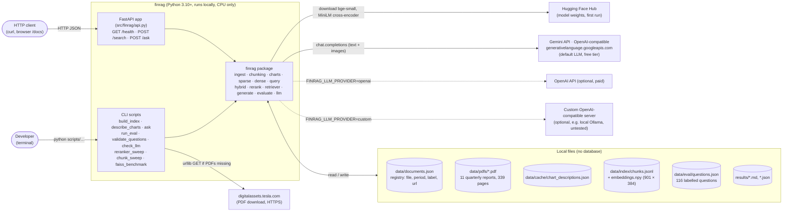
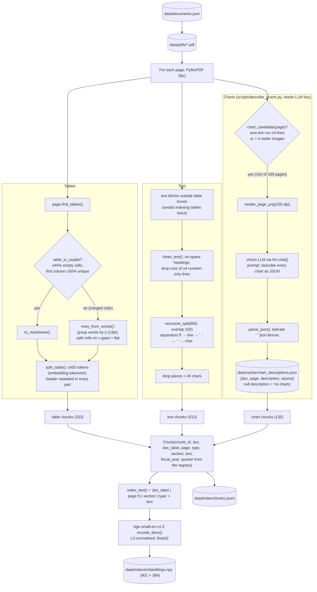
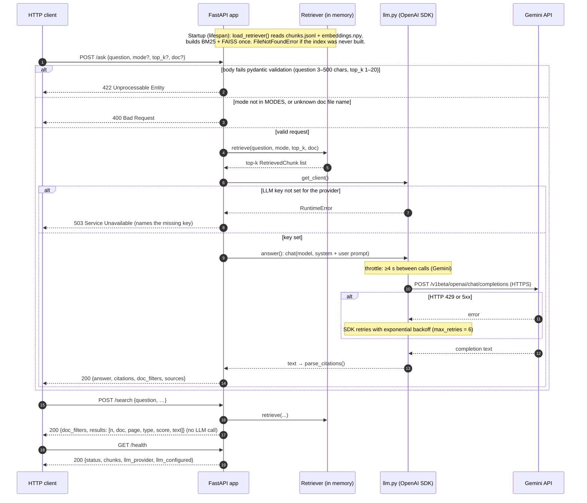
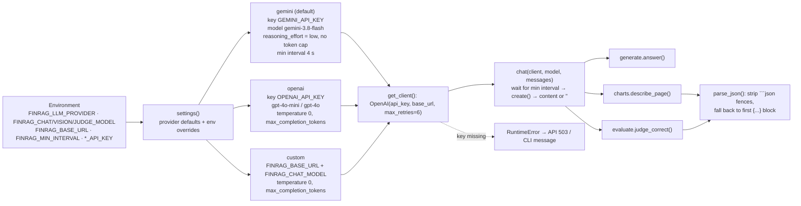
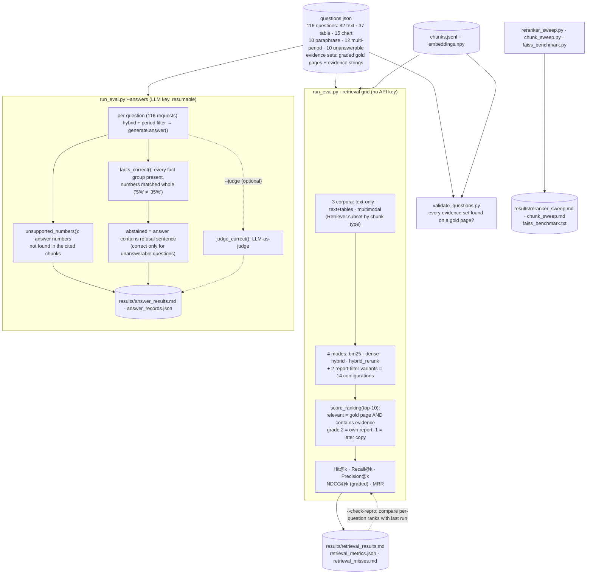

# Architecture

Diagrams of the financial multimodal RAG system, derived from the code in `src/finrag/` and `scripts/`.
Each diagram's source is an editable Mermaid file in [`docs/architecture/`](architecture/); this page is
generated from them by `python docs/architecture/build_markdown.py`.

**Not implemented** (do not read these into the diagrams): authentication, a database, a web UI,
streaming responses, Docker/deployment, background job queues. Planned work is listed under
*Next steps* in the README.

## System context

01 · System context: who uses the system, what it stores, which external services it calls.  
_Source: [`architecture/01-system-context.mmd`](architecture/01-system-context.mmd)_ · Source of truth: scripts/*.py, src/finrag/api.py, src/finrag/llm.py, src/finrag/config.py



## Offline ingestion

02 · Offline ingestion: PDF pages -> typed chunks -> embeddings on disk.  
_Source: [`architecture/02-ingestion-pipeline.mmd`](architecture/02-ingestion-pipeline.mmd)_ · Source of truth: scripts/build_index.py, scripts/describe_charts.py, src/finrag/ingest.py, chunking.py, charts.py, dense.py, retriever.py (save_index)



## Online query

03 · Online query: question -> retrieval funnel -> grounded answer with citations.  
_Source: [`architecture/03-query-pipeline.mmd`](architecture/03-query-pipeline.mmd)_ · Source of truth: src/finrag/query.py (parse_periods), retriever.py (Retriever.retrieve, report_filters), sparse.py, dense.py, hybrid.py, rerank.py, generate.py, config.py

```mermaid
%% 03 · Online query: question -> retrieval funnel -> grounded answer with citations.
%% Source of truth: src/finrag/query.py (parse_periods), retriever.py (Retriever.retrieve, report_filters),
%%                  sparse.py, dense.py, hybrid.py, rerank.py, generate.py, config.py
flowchart LR
    q(["question"]) --> pp["parse_periods(): 'Q3 2024', '3Q-2024',<br/>'third quarter of 2024', 'Q1, Q2 and Q3 2024',<br/>full-year 2024 → Q4 2024 report"]
    pp --> f{"periods named<br/>(doc = 'auto')"}
    f -- "one, with a report" --> k1a["k1 = all chunks, keep only that report"]
    f -- "none" --> k1b["k1 = 50, all reports"]
    f -- "several" --> dec["decomposition: one search per period's report<br/>(merged round-robin, duplicates dropped)"]
    dec --> k1a

    k1a --> bm25
    k1b --> bm25
    k1a --> dense
    k1b --> dense

    bm25["BM25Okapi (k1 1.5, b 0.75)<br/>number-aware tokenizer:<br/>'7.6%', '51105' stay whole"] --> rrf
    dense["FAISS IndexFlatIP (exact, cosine)<br/>query = BGE prefix + question"] --> rrf
    rrf["Reciprocal Rank Fusion<br/>score = Σ 1 / (60 + rank)"] --> mode{"mode"}

    mode -- "hybrid (default)" --> top5["top-8 RetrievedChunk<br/>(chunk, score, ranks)"]
    mode -. "hybrid_rerank (optional,<br/>lowered MRR 0.692→0.636)" .-> ce["cross-encoder ms-marco-MiniLM-L-6-v2<br/>scores top-20, batch 4, max 512 tokens<br/>(loaded lazily on first use)"]
    ce -.-> top5

    top5 --> ctx["build_context():<br/>[n] (doc_label, page, type) + text"]
    ctx --> llm["llm.chat(): system prompt rules<br/>only sources · cite [n] · exact numbers<br/>chart values 'approximately' · abstain"]
    llm --> pc["parse_citations(): [2], [1, 3], [1][2]<br/>drop out-of-range numbers"]
    pc --> out(["{answer, citations: [{n, doc, page, type}]}"])
    llm -. "no answer in sources" .-> abst(["'I could not find this in the provided documents.'"])
```



## REST API

04 · REST API: request/response flow with error paths.  
_Source: [`architecture/04-api-sequence.mmd`](architecture/04-api-sequence.mmd)_ · Source of truth: src/finrag/api.py, retriever.py, llm.py, generate.py



## LLM provider layer

05 · LLM provider layer: one OpenAI-compatible client, three providers.  
_Source: [`architecture/05-llm-provider.mmd`](architecture/05-llm-provider.mmd)_ · Source of truth: src/finrag/llm.py



## Evaluation workflow

06 · Evaluation workflow: labels -> retrieval grid -> answer correctness -> reports.  
_Source: [`architecture/06-evaluation.mmd`](architecture/06-evaluation.mmd)_ · Source of truth: scripts/validate_questions.py, scripts/run_eval.py, src/finrag/evaluate.py



## Data model

07 · Data model: in-memory types and on-disk records (there is no database).  
_Source: [`architecture/07-data-model.mmd`](architecture/07-data-model.mmd)_ · Source of truth: src/finrag/schema.py, retriever.py, ingest.py, charts.py, evaluate.py

```mermaid
%% 07 · Data model: in-memory types and on-disk records (there is no database).
%% Source of truth: src/finrag/schema.py, retriever.py, ingest.py, charts.py, evaluate.py
classDiagram
    class Chunk {
        +str chunk_id   "doc:pN:text0 / table0.1 / chart0"
        +str doc        "PDF file name"
        +str doc_label  "human-readable report name"
        +int page       "1-based, used in citations"
        +str type       "text | table | chart"
        +str section    "page heading"
        +str text
        +int fiscal_year "from the registry"
        +int quarter
        +index_text() str
        +citation() str
    }
    class RetrievedChunk {
        +Chunk chunk
        +float score
        +dict ranks   "bm25, dense, rrf, period"
    }
    class ChartCacheEntry {
        +str doc
        +int page
        +str description   "null = page checked, no charts"
        +str source        "vision model that produced it"
    }
    class Question {
        +str id
        +str type          "text | table | chart | paraphrase | multi | unanswerable"
        +str question
        +list evidence_sets "{gold: [period, page, grade], evidence}"
        +list answer_facts "groups of alternatives"
    }
    class AnswerRecord {
        +str modality
        +str id
        +str model
        +str answer
        +list citations
        +bool abstained
        +bool fact_match   "null for unanswerable"
        +list unsupported_numbers
        +bool judge        "optional"
    }
    RetrievedChunk --> Chunk : wraps
    ChartCacheEntry ..> Chunk : becomes a chart chunk
    Question ..> RetrievedChunk : is_relevant()
    AnswerRecord ..> Question : scored against answer_facts
```
